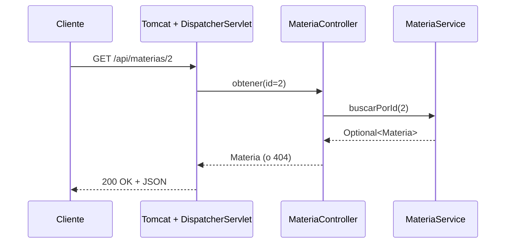

# INICIALESact1_t4 · API REST con Spring Boot

> Proyecto didáctico de la **Actividad 1 – Tema 4**: una API REST mínima construida con
> **Spring Boot** que se prueba en local y se despliega como archivo `.jar` en un **VPS**
> con `nohup`. 


## Tabla de contenido

1. [Tecnologías utilizadas](#1-tecnologías-utilizadas)
2. [Arquitectura](#2-arquitectura)
3. [Requisitos para ejecutar el proyecto](#3-requisitos-para-ejecutar-el-proyecto)
4. [Cómo ejecutar el proyecto](#4-cómo-ejecutar-el-proyecto)
5. [Endpoints disponibles](#5-endpoints-disponibles)
6. [Estructura del proyecto](#6-estructura-del-proyecto)
7. [Despliegue en el VPS](#7-despliegue-en-el-vps)
8. [Solución de problemas](#8-solución-de-problemas)
9. [Documentación adicional](#9-documentación-adicional)
10. [Recursos de aprendizaje](#10-recursos-de-aprendizaje)
11. [Estándares y convenciones](#11-estándares-y-convenciones)

---

## 1. Tecnologías utilizadas

Cada tecnología se explica con tres preguntas: **qué es**, **para qué sirve** y
**cómo se configuró y se usó en este proyecto**. El detalle ampliado está en
[`docs/TECNOLOGIAS.md`](docs/TECNOLOGIAS.md).

### 1.1 Java (JDK 17)

- **Qué es:** lenguaje de programación y plataforma (JDK = compilador `javac` + máquina virtual `java` + librerías).
- **Para qué sirve:** compilar y ejecutar la aplicación. El resultado se ejecuta en cualquier sistema que tenga Java.
- **Cómo se usa aquí:** en el [`pom.xml`](pom.xml) se fija `<java.version>17</java.version>`; el código usa
  `record` (Java 16+) para los modelos. El mismo JDK debe estar en tu equipo y en el VPS.

### 1.2 Maven

- **Qué es:** herramienta de construcción y gestión de dependencias.
- **Para qué sirve:** descargar librerías, compilar, ejecutar pruebas y empaquetar el `.jar`.
- **Cómo se usa aquí:** el archivo [`pom.xml`](pom.xml) declara el *parent* de Spring Boot (versiones compatibles),
  las dependencias y el plugin que genera el `.jar` ejecutable. Comandos clave:

  | Comando | Qué hace |
  |---|---|
  | `mvn spring-boot:run` | Compila y arranca la aplicación |
  | `mvn test` | Ejecuta las pruebas |
  | `mvn clean package` | Limpia, prueba y genera `target/act1-t4.jar` |

### 1.3 Spring Boot

- **Qué es:** framework que simplifica crear aplicaciones Spring: *autoconfiguración*, servidor embebido y
  *starters* (paquetes de dependencias listos).
- **Para qué sirve:** levantar una aplicación web con muy poca configuración.
- **Cómo se usa aquí:** la clase [`Act1T4Application`](src/main/java/com/example/act1t4/Act1T4Application.java)
  tiene `@SpringBootApplication` y el método `main`. Versión: **3.5.7**.

### 1.4 Spring Web (`spring-boot-starter-web`)

- **Qué es:** el starter que trae **Spring MVC**, **Tomcat embebido** y **Jackson**.
- **Para qué sirve:** definir *controladores* que responden peticiones HTTP, y convertir objetos Java a JSON.
- **Cómo se usa aquí:** dos `@RestController` ([`ProyectoController`](src/main/java/com/example/act1t4/controller/ProyectoController.java)
  y [`MateriaController`](src/main/java/com/example/act1t4/controller/MateriaController.java)) con `@GetMapping`.
  No hay que instalar un servidor aparte: Tomcat está dentro del `.jar`.

### 1.5 Tomcat embebido

- **Qué es:** el servidor web/servlet que se incluye dentro de la aplicación.
- **Para qué sirve:** escuchar en un puerto y entregar las peticiones a Spring MVC.
- **Cómo se configuró:** el puerto se define en `application.properties` con
  `server.port=${SERVER_PORT:8080}` (8080 por defecto) y en el VPS se sobrescribe con `--server.port=8081`.

### 1.6 Jackson

- **Qué es:** librería que convierte objetos Java ⇄ JSON.
- **Cómo se usa aquí:** automático. Los `record` `Materia` y `EstadoResponse` se devuelven desde los
  controladores y Spring los serializa a JSON sin código extra.

### 1.7 `@ConfigurationProperties`

- **Qué es:** mecanismo de Spring Boot para leer propiedades tipadas desde `application.properties`.
- **Cómo se usa aquí:** [`ProyectoProperties`](src/main/java/com/example/act1t4/config/ProyectoProperties.java)
  enlaza `proyecto.nombre`, `proyecto.autor` y `proyecto.descripcion`. Así el nombre del proyecto se cambia
  **sin tocar código Java**.

### 1.8 JUnit 5 + MockMvc (pruebas)

- **Qué es:** JUnit es el framework de pruebas; MockMvc simula peticiones HTTP sin levantar un servidor real.
- **Cómo se usa aquí:** carpeta [`src/test`](src/test/java/com/example/act1t4) con una prueba por endpoint
  (se verifica código HTTP, tipo de contenido y cuerpo).

### 1.9 Git y GitHub

- **Para qué sirven:** control de versiones y alojamiento del repositorio. El archivo
  [`.gitignore`](.gitignore) evita subir `target/`, configuraciones de IDE, logs y secretos.

### 1.10 Linux (VPS), SSH/SCP, UFW y `nohup`

- **SSH/SCP:** conexión segura al servidor y copia del `.jar` desde tu equipo.
- **UFW:** firewall sencillo de Ubuntu; se abre solo el puerto asignado.
- **`nohup`:** mantiene el proceso vivo aunque cierres la sesión SSH.
- Todo el procedimiento está en [`docs/DESPLIEGUE_VPS.md`](docs/DESPLIEGUE_VPS.md).

---

## 2. Arquitectura

La aplicación sigue una **arquitectura en capas** simple, con una sola unidad de despliegue (un `.jar`).

```
 Cliente (navegador / Postman / curl)
              │  HTTP  GET /api/materias
              ▼
 ┌───────────────────────────────────────────────┐
 │  Tomcat embebido  (puerto configurable)         │
 │   └─ DispatcherServlet (Spring MVC)             │
 │        └─ Controller   → recibe la petición     │
 │             └─ Service → lógica / datos         │
 │                  └─ Model (record) → JSON       │
 └───────────────────────────────────────────────┘
```



| Capa | Paquete | Responsabilidad |
|---|---|---|
| Controlador | `controller` | Expone endpoints HTTP; no contiene lógica de negocio |
| Servicio | `service` | Lógica de negocio y acceso a datos (simulados en memoria) |
| Modelo | `model` | Objetos de datos inmutables (`record`) |
| Configuración | `config` | Propiedades tipadas del proyecto |

Más detalle, decisiones de diseño y diagrama de despliegue en [`docs/ARQUITECTURA.md`](docs/ARQUITECTURA.md).

---

## 3. Requisitos para ejecutar el proyecto

| Herramienta | Versión mínima | Versión probada/recomendada | Obligatoria | Dónde obtenerla |
|---|---|---|---|---|
| **JDK** | 17 | 17 o 21 (LTS) | Sí | [Adoptium Temurin](https://adoptium.net/) · Linux: `sudo apt install openjdk-17-jdk` |
| **Maven** | 3.6.3 | 3.9.x | Sí (o usar el Maven integrado del IDE) | [maven.apache.org](https://maven.apache.org/download.cgi) · Linux: `sudo apt install maven` |
| **Git** | 2.x | última | Sí, para clonar/subir | [git-scm.com](https://git-scm.com/downloads) |
| **IDE** | — | IntelliJ IDEA Community, Eclipse/STS o VS Code + *Extension Pack for Java* | Recomendado | [jetbrains.com/idea](https://www.jetbrains.com/idea/download/) |
| **Postman** o **curl** | — | cualquiera | Opcional (el navegador basta) | [postman.com](https://www.postman.com/downloads/) |

Dependencias que Maven descarga solo (no se instalan a mano): Spring Boot 3.5.7, Spring Framework 6.2.x,
Tomcat 10.1.x, Jackson 2.19.x y JUnit 5.12.x (versiones gestionadas por el *parent* de Spring Boot).

### Verificar la instalación

```bash
java -version      # debe mostrar 17 o superior
mvn -version       # debe mostrar Maven 3.6.3+ y "Java version: 17+"
git --version
```

> **Windows:** puedes instalar con `winget install EclipseAdoptium.Temurin.17.JDK` y `winget install Apache.Maven`.
> Si `mvn` no se reconoce, agrega la carpeta `bin` de Maven al `PATH` y define `JAVA_HOME`.

---

## 4. Cómo ejecutar el proyecto

### 4.1 Obtener el código

```bash
git clone enlace de este repositorio ...

```

### 4.2 Personalizar (una sola vez)

Edita `src/main/resources/application.properties`:

```properties
proyecto.nombre=TUSINICIALESact1_t4
proyecto.autor=Apellidos Nombre
```

### 4.3 Ejecutar en local (elige una opción)

**Opción A – Maven (terminal):**

```bash
mvn spring-boot:run
```

**Opción B – IDE:** abre el proyecto como *Maven project*, localiza `Act1T4Application.java` y pulsa
**Run**.

**Opción C – Generar y ejecutar el `.jar`:**

```bash
mvn clean package
java -jar target/act1-t4.jar
```

Sabrás que todo salió bien cuando la consola muestre algo como:

```
Tomcat started on port 8080 (http) with context path '/'
Started Act1T4Application in 2.1 seconds
```

### 4.4 Cambiar el puerto (sin recompilar)

```bash
java -jar target/act1-t4.jar --server.port=8081
# o con variable de entorno
SERVER_PORT=8081 java -jar target/act1-t4.jar          # Linux / macOS
$env:SERVER_PORT=8081; java -jar target/act1-t4.jar    # Windows PowerShell
```

### 4.5 Probar los endpoints

Con el servidor corriendo, abre en el navegador o usa `curl`:

```bash
curl http://localhost:8080/api/proyecto/nombre
curl http://localhost:8080/api/proyecto/estado
curl http://localhost:8080/api/materias
curl http://localhost:8080/api/materias/2
curl -i http://localhost:8080/api/materias/99     # 404
```

En **Postman**: método `GET`, URL `http://localhost:8080/api/materias`, botón **Send**.

### 4.6 Ejecutar las pruebas automatizadas

```bash
mvn test
```

### 4.7 Detener la aplicación

`Ctrl + C` en la terminal donde corre (o el botón **Stop** del IDE).

---

## 5. Endpoints disponibles

| # | Método | Ruta | Controlador | Respuesta | Descripción |
|---|---|---|---|---|---|
| 1 | GET | `/api/proyecto/nombre` | `ProyectoController` | Texto plano | Nombre del proyecto (identifica la instancia) |
| 2 | GET | `/api/proyecto/estado` | `ProyectoController` | JSON (objeto) | Estado, autor, versión de Java, puerto y fecha |
| 3 | GET | `/api/materias` | `MateriaController` | JSON (lista) | Lista simulada de materias |
| 4 | GET | `/api/materias/{id}` | `MateriaController` | JSON (objeto) / 404 | Una materia por su id |

Ejemplos de respuesta y códigos HTTP en [`docs/API.md`](docs/API.md).

---

## 6. Estructura del proyecto

```
TUSINICIALESact1_t4/
├── pom.xml                         # Dependencias y construcción (Maven)
├── README.md                       # Este archivo
├── CHANGELOG.md                    # Historial de cambios
├── .gitignore  .gitattributes  .editorconfig
├── docs/                           # Documentación ampliada
│   ├── ARQUITECTURA.md
│   ├── TECNOLOGIAS.md
│   ├── CONFIGURACION.md
│   ├── API.md
│   ├── CONSTRUCCION_PASO_A_PASO.md
│   ├── DESPLIEGUE_VPS.md
│   └── ENTREGA_CLASSROOM.md
├── scripts/
│   └── vps-run.sh                  # Iniciar/detener la app en el VPS con nohup
└── src/
    ├── main/
    │   ├── java/com/example/act1t4/
    │   │   ├── Act1T4Application.java
    │   │   ├── config/ProyectoProperties.java
    │   │   ├── controller/{ProyectoController, MateriaController}.java
    │   │   ├── model/{Materia, EstadoResponse}.java
    │   │   └── service/MateriaService.java
    │   └── resources/application.properties
    └── test/java/com/example/act1t4/   # Pruebas JUnit + MockMvc
```

---

## 7. Despliegue en el VPS

Resumen (la guía completa con comandos y solución de problemas está en
[`docs/DESPLIEGUE_VPS.md`](docs/DESPLIEGUE_VPS.md)):

```bash
# 1) En tu equipo: generar el .jar
mvn clean package

# 2) En el VPS (una vez): instalar Java y abrir tu puerto
sudo apt update && sudo apt install -y openjdk-17-jdk
java -version
sudo ufw allow 8081/tcp

# 3) Copiar el .jar y el script al VPS
scp target/act1-t4.jar scripts/vps-run.sh usuario@IP_DEL_VPS:~/act1-t4/

# 4) En el VPS: ejecutar con nohup en tu puerto
cd ~/act1-t4 && chmod +x vps-run.sh && PORT=8081 ./vps-run.sh start

# 5) Verificar desde fuera
curl http://IP_DEL_VPS:8081/api/proyecto/nombre
```

> Cada integrante del equipo debe usar **un puerto distinto** (por ejemplo 8081 y 8082) y su propia carpeta.

---

## 8. Solución de problemas

| Síntoma | Causa probable | Solución |
|---|---|---|
| `Port 8080 was already in use` | Otro proceso usa el puerto | Cambia el puerto: `--server.port=8081` |
| `java: invalid target release: 17` / `release version 17 not supported` | JDK anterior a 17 | Instala JDK 17+ y verifica `JAVA_HOME` |
| `UnsupportedClassVersionError` en el VPS | El VPS tiene un Java más viejo que el usado para compilar | Instala JDK 17+ en el VPS |
| `mvn` no se reconoce | Maven fuera del `PATH` | Agrega `<maven>/bin` al `PATH` o usa el Maven del IDE |
| El VPS responde con `curl localhost` pero no desde fuera | Firewall (UFW o del proveedor) | `sudo ufw allow PUERTO/tcp` y revisa reglas del proveedor |
| Al cerrar SSH se cae la app | Se ejecutó sin `nohup` | Usa `nohup ... &` o `scripts/vps-run.sh` |
| `Whitelabel Error Page` / 404 | Ruta mal escrita | Revisa la tabla de [endpoints](#5-endpoints-disponibles) |

---

## 9. Documentación adicional

| Documento | Contenido |
|---|---|
| [`docs/TECNOLOGIAS.md`](docs/TECNOLOGIAS.md) | Cada tecnología a detalle: qué es, para qué sirve, configuración y uso |
| [`docs/ARQUITECTURA.md`](docs/ARQUITECTURA.md) | Capas, flujo de una petición, decisiones de diseño, despliegue |
| [`docs/CONFIGURACION.md`](docs/CONFIGURACION.md) | `pom.xml`, `application.properties`, puertos, perfiles |
| [`docs/API.md`](docs/API.md) | Referencia de endpoints con ejemplos |
| [`docs/CONSTRUCCION_PASO_A_PASO.md`](docs/CONSTRUCCION_PASO_A_PASO.md) | Cómo se construyó el proyecto desde cero, con código |
| [`docs/DESPLIEGUE_VPS.md`](docs/DESPLIEGUE_VPS.md) | Despliegue completo en el VPS con `nohup` |
| [`docs/ENTREGA_CLASSROOM.md`](docs/ENTREGA_CLASSROOM.md) | Lista de verificación de entrega y borrador de respuestas |
| [`CHANGELOG.md`](CHANGELOG.md) | Historial de versiones |

---

## 10. Recursos de aprendizaje

Playlist de la actividad (videos 1 al 7):

1. <https://www.youtube.com/watch?v=5M39KMhVOWA>
2. <https://www.youtube.com/watch?v=pQGxVgaNM-o>
3. <https://www.youtube.com/watch?v=2pUsaEN9sLM>
4. <https://www.youtube.com/watch?v=kgDWpAbADpo>
5. <https://www.youtube.com/watch?v=by92q8THhrE>
6. <https://www.youtube.com/watch?v=WIUTaPgOqRg>
7. <https://www.youtube.com/watch?v=H_Bjxu0qb64>

Documentación oficial: [Spring Boot](https://docs.spring.io/spring-boot/) ·
[Spring MVC](https://docs.spring.io/spring-framework/reference/web/webmvc.html) ·
[Maven](https://maven.apache.org/guides/) · [Spring Initializr](https://start.spring.io/)

---

## 11. Estándares y convenciones

- **Versionado:** [SemVer](https://semver.org/lang/es/) · **Changelog:** [Keep a Changelog](https://keepachangelog.com/es-ES/1.1.0/).
- **Commits:** [Conventional Commits](https://www.conventionalcommits.org/es/v1.0.0/) (`feat:`, `fix:`, `docs:`, `test:`, `chore:`).
- **Código:** convenciones de nomenclatura de Java (clases `PascalCase`, métodos y variables `camelCase`),
  Javadoc en clases públicas, inyección de dependencias por constructor.
- **API:** rutas en minúsculas bajo el prefijo `/api`, recursos en plural (`/api/materias`), códigos HTTP semánticos.
- **Estilo del editor:** definido en [`.editorconfig`](.editorconfig).

## Autor

**Apellidos Nombre** · Actividad 1 – Tema 4
