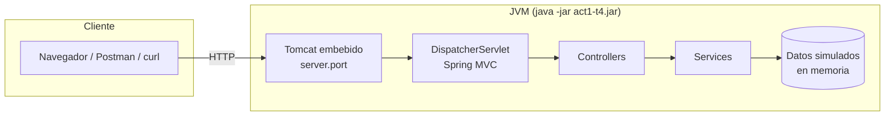
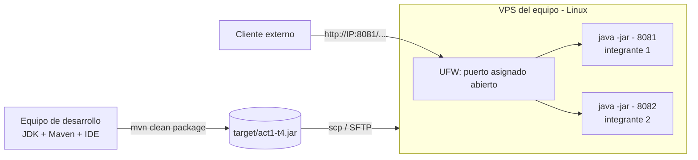

# Arquitectura

## 1. Visión general

Aplicación **monolítica** de una sola unidad de despliegue (`act1-t4.jar`) con **arquitectura en capas**.
El `.jar` incluye el código, las librerías y el servidor Tomcat, por lo que solo requiere Java para ejecutarse.

## 2. Capas y responsabilidades

| Capa | Clases | Responsabilidad | No debe hacer |
|---|---|---|---|
| Presentación (web) | `ProyectoController`, `MateriaController` | Mapear rutas HTTP, recibir parámetros, devolver respuesta y código HTTP | Lógica de negocio |
| Negocio / datos | `MateriaService` | Obtener y filtrar materias | Conocer HTTP |
| Modelo | `Materia`, `EstadoResponse` | Representar los datos (inmutables) | Lógica |
| Configuración | `ProyectoProperties` | Exponer propiedades tipadas | — |
| Arranque | `Act1T4Application` | Iniciar Spring Boot | — |

**Regla de dependencia:** `controller → service → model`. Las capas superiores conocen a las inferiores, nunca al revés.

## 3. Flujo de una petición

1. El cliente envía `GET /api/materias/2` al puerto del servidor.
2. **Tomcat** recibe la conexión y entrega la petición al **DispatcherServlet**.
3. El DispatcherServlet busca el método cuyo mapeo coincide (`@RequestMapping("/api/materias")` + `@GetMapping("/{id}")`).
4. Se invoca `MateriaController.obtener(2)`; `@PathVariable` convierte `"2"` a `int`.
5. El controlador llama a `MateriaService.buscarPorId(2)`.
6. Si existe, el objeto `Materia` se devuelve y **Jackson** lo convierte a JSON (`@RestController` implica `@ResponseBody`).
   Si no existe, se lanza `ResponseStatusException(404)`.
7. Tomcat envía la respuesta HTTP al cliente.

## 4. Decisiones de diseño

| Decisión | Motivo |
|---|---|
| `@RestController` en lugar de `@Controller` | Todas las respuestas son datos (texto/JSON), no vistas HTML |
| Inyección de dependencias por constructor | Facilita pruebas, deja las dependencias explícitas y permite campos `final` |
| `record` para modelos | Inmutables, sin código repetitivo (getters, `equals`, `toString`) |
| Datos simulados en un servicio | El objetivo de la actividad es el ciclo controlador → respuesta; un repositorio real es el siguiente paso natural |
| `@ConfigurationProperties` | El nombre/autor se cambia por configuración, sin recompilar |
| Puerto externalizado (`SERVER_PORT` / `--server.port`) | Cada integrante usa un puerto distinto en el VPS sin cambiar código |
| `finalName` fijo en el `pom.xml` | El artefacto siempre se llama `act1-t4.jar`, fácil de copiar y documentar |

## 5. Diagrama de despliegue

## 6. Evolución sugerida

- Reemplazar el servicio en memoria por **Spring Data JPA** + base de datos.
- Añadir validación (`spring-boot-starter-validation`) y manejo global de errores (`@RestControllerAdvice`).
- Añadir **Actuator** para *health checks*.
- Contenerizar con Docker.
- Automatizar el despliegue (GitHub Actions) y ejecutar como servicio `systemd`.
