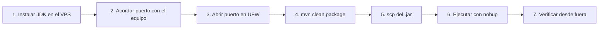

# Despliegue en el VPS

Guía para publicar la aplicación en el VPS del equipo como `.jar` con `nohup`.
Reemplaza los valores en MAYÚSCULAS: `USUARIO`, `IP_DEL_VPS`, `TU_PUERTO`.

> **Antes de empezar:** el proyecto debe funcionar en tu máquina local (`mvn test` y `java -jar target/act1-t4.jar`).
> No subas nada al VPS hasta que todo funcione localmente.

## Resumen del flujo



## 1. Conectarte al VPS

```bash
ssh USUARIO@IP_DEL_VPS
```

## 2. Instalar el JDK (si aún no está)

```bash
sudo apt update
sudo apt install -y openjdk-17-jdk
java -version          # debe mostrar openjdk version "17..."
```

> Si el VPS solo necesita **ejecutar**, basta `openjdk-17-jre-headless`. Si ya hay un Java 17 o superior, no reinstales.
> El Java del VPS debe ser **igual o mayor** al `java.version` del `pom.xml`.

## 3. Acordar el puerto con tu equipo

En un mismo servidor **solo un proceso puede escuchar en un puerto**. Si dos integrantes usan el 8080, el segundo falla con
`Port 8080 was already in use`. Acuerden, por ejemplo:

| Integrante | Puerto |
|---|---|
| 1 | 8081 |
| 2 | 8082 |

Revisa que el tuyo esté libre:

```bash
ss -tlnp | grep TU_PUERTO       # sin salida = libre
```

## 4. Abrir el puerto en el firewall

```bash
sudo ufw status
sudo ufw allow TU_PUERTO/tcp
sudo ufw status                 # confirma la regla
```

> Si UFW aparece como `inactive`, **no es necesario activarlo**. Si decides activarlo, permite SSH primero
> (`sudo ufw allow OpenSSH`) o perderás el acceso al servidor.
> Algunos proveedores (AWS, Azure, Oracle…) tienen además un firewall externo (*Security Group*): abre el puerto allí también.

## 5. Generar el `.jar` (en tu equipo)

```bash
mvn clean package
ls -lh target/act1-t4.jar
```

## 6. Subir el `.jar` al VPS

Crea tu carpeta de trabajo (una por integrante, para no mezclar archivos):

```bash
ssh USUARIO@IP_DEL_VPS "mkdir -p ~/act1-t4"
```

Copia el `.jar` y el script (desde la carpeta del proyecto, en tu equipo):

```bash
scp target/act1-t4.jar scripts/vps-run.sh USUARIO@IP_DEL_VPS:~/act1-t4/
```

> **SFTP gráfico:** también puedes usar WinSCP o FileZilla (protocolo SFTP, puerto 22) y arrastrar el archivo a `~/act1-t4/`.
> **Windows:** `scp` viene incluido en PowerShell/Windows 10+.

## 7. Ejecutar con `nohup`

### Opción A – Con el script incluido (recomendada)

```bash
cd ~/act1-t4
chmod +x vps-run.sh
PORT=TU_PUERTO ./vps-run.sh start
./vps-run.sh status
./vps-run.sh logs               # Ctrl+C para salir del log (la app sigue corriendo)
```

### Opción B – Comando manual

```bash
cd ~/act1-t4
nohup java -jar act1-t4.jar --server.port=TU_PUERTO > app.log 2>&1 &
echo $! > app.pid
```

| Parte | Significado |
|---|---|
| `nohup` | Evita que el proceso muera al cerrar la sesión SSH |
| `--server.port=TU_PUERTO` | Sobrescribe el puerto del `application.properties` |
| `> app.log 2>&1` | Guarda salida normal y errores en `app.log` |
| `&` | Ejecuta en segundo plano |
| `echo $! > app.pid` | Guarda el PID para poder detenerlo después |

Revisa que arrancó:

```bash
tail -n 20 app.log              # busca: Tomcat started on port TU_PUERTO
ss -tlnp | grep TU_PUERTO       # debe aparecer java escuchando
```

## 8. Verificar

**Desde el propio VPS:**

```bash
curl http://localhost:TU_PUERTO/api/proyecto/nombre
```

**Desde fuera (tu equipo o el navegador):**

```
http://IP_DEL_VPS:TU_PUERTO/api/proyecto/nombre
http://IP_DEL_VPS:TU_PUERTO/api/proyecto/estado
http://IP_DEL_VPS:TU_PUERTO/api/materias
http://IP_DEL_VPS:TU_PUERTO/api/materias/2
```

El campo `puerto` de `/api/proyecto/estado` y el nombre de `/api/proyecto/nombre` confirman que estás viendo **tu** instancia.
Toma capturas de pantalla como evidencia.

## 9. Actualizar a una nueva versión

```bash
# en tu equipo
mvn clean package
scp target/act1-t4.jar USUARIO@IP_DEL_VPS:~/act1-t4/

# en el VPS
cd ~/act1-t4 && PORT=TU_PUERTO ./vps-run.sh restart
```

## 10. Detener la aplicación

```bash
cd ~/act1-t4 && ./vps-run.sh stop
# manual: kill $(cat app.pid)
```

> **Cuidado en un VPS compartido:** no uses `pkill java` ni `killall java`: detendrías también los procesos de tus compañeros.
> Usa siempre el PID guardado en `app.pid`.

## 11. Solución de problemas

| Síntoma | Causa probable | Solución |
|---|---|---|
| `Port ... was already in use` | Puerto ocupado por otro integrante | Elige otro puerto y vuelve a iniciar |
| `UnsupportedClassVersionError` | Java del VPS más antiguo que el de compilación | Instala JDK 17+ en el VPS |
| `curl localhost:PUERTO` funciona pero desde fuera no | Firewall (UFW o del proveedor) | `sudo ufw allow PUERTO/tcp` y revisa el firewall del proveedor |
| `Connection refused` desde fuera | La app no está corriendo o escucha en otro puerto | `./vps-run.sh status` y `tail app.log` |
| `Permission denied` al ejecutar el script | Falta permiso de ejecución | `chmod +x vps-run.sh` |
| `bad interpreter: /usr/bin/env bash^M` | Script guardado con saltos de línea de Windows (CRLF) | `sed -i 's/\r$//' vps-run.sh` |
| La app se cae al cerrar SSH | Se ejecutó sin `nohup` | Usa `nohup ... &` o el script |
| `scp: Permission denied` | Usuario/clave incorrectos o carpeta sin permisos | Verifica el usuario y que `~/act1-t4` exista |

## 12. (Opcional) Ejecutarlo como servicio `systemd`

`nohup` es suficiente para la actividad, pero un servicio se reinicia solo si el servidor se reinicia. Ejemplo
`/etc/systemd/system/act1-t4.service`:

```ini
[Unit]
Description=Actividad 1 Tema 4 - Spring Boot
After=network.target

[Service]
User=USUARIO
WorkingDirectory=/home/USUARIO/act1-t4
ExecStart=/usr/bin/java -jar /home/USUARIO/act1-t4/act1-t4.jar --server.port=TU_PUERTO
Restart=on-failure

[Install]
WantedBy=multi-user.target
```

```bash
sudo systemctl daemon-reload
sudo systemctl enable --now act1-t4
sudo systemctl status act1-t4
journalctl -u act1-t4 -f
```

> En un VPS compartido, usa un nombre de servicio distinto por integrante.
